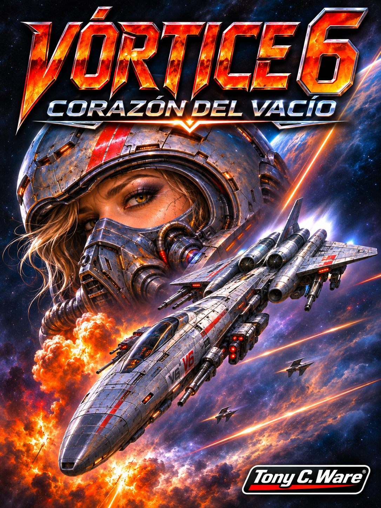

# VÓRTICE 6 — CORAZÓN DEL VACÍO

**Euroshooter de scroll horizontal para Atari XL/XE (64 KB).** Cinco fases, cinco jefes, tres dificultades, intro narrativa y final cinematográfico.

**© 2026 Tony C. Ware**

## La historia

El Sarcófago de Sacrificios de Saturno vuelve a palpitar con rituales prohibidos. El Oficiante Vacío busca resucitar al ordenador estelar **Leviatán V**. Para detenerlo, la Federación envía a **la Comandante Elara Voss**, descendiente del piloto que salvó la galaxia, a bordo del nuevo **Vórtice 6**.

Su misión: **destruir el Corazón del Vacío**.

[Historia completa](HISTORIA.md).

## Descargar y jugar

Descarga los archivos de la [Release V1.0](../../releases/tag/v1.0):

| Archivo | Uso |
|---|---|
| `vortice6.car` | Juego completo en cartucho **AtariMax 8 Mbit (CAR tipo 42)**, cargas instantáneas |
| `vortice6.atr` | Juego completo en disco de doble densidad (180 KB), autoarrancable y sin DOS |
| `VORTICE6_Todo.zip` | Código fuente, banco de trabajo, capturas reales, pistas musicales, atlas y XEX individuales |

**Requisitos:** Atari XL/XE de 64 KB; recomendado NTSC a 60 Hz. En PAL funciona algo más lento. Para ATR hace falta unidad de doble densidad, FujiNet, SIO2SD, SIO2PC o emulador compatible.

**Controles:** joystick puerto 1 para mover la nave; FIRE dispara y mantenido activa disparo automático. En el panel de mando izquierda/derecha eligen dificultad, FIRE comienza. FIRE también permite saltar la introducción.

## Las cinco fases

1. **Desguace espacial** — FERRUM-9.
2. **Océanos astrales** — THALASSA.
3. **Hades** — El Tríptico.
4. **Sarcófago de Saturno** — SATURNUS.
5. **Nave viviente** — El Corazón Nulo.

El juego incluye oleadas por detrás, bucles, patrullas, cargas y escaleras; enemigos especiales como Unidad Cero, obstáculos y puertas de rayos.

## Material del proyecto

- [Atlas oficial en PDF](documentacion/VORTICE6_Atlas.pdf): historia, instrucciones, mapas, capturas, jefes, unidades y memoria técnica.
- [Fuentes 6502 y herramientas Python](VORTICE6/fuentes/): compilación con cc65. El script `build_disco.sh` construye discos y cartucho.
- [Capturas reales](VORTICE6/capturas/): imágenes de la versión final, sin maquetas.
- [Música](VORTICE6/musica/): ocho grabaciones en MP3.
- [Banco de trabajo](banco_de_trabajo_atari8bits/): utilidades, documentación y guía técnica.

**Integridad del cartucho:** SHA-256 `6461f020a6e339973b32077c1ac84e2c5190c9ef13ecc22fbb09a171e202d278`.

## Créditos

- **Dirección y diseño:** Tony C. Ware.
- **Gráficos, fases y música:** Tony C. Ware.
- **Programa y asistencia:** GPT y Claude.

Proyecto independiente y aficionado. Atari es marca de sus respectivos titulares. Consulta `LICENSE` para la licencia existente del repositorio; los derechos del arte y la música pueden ser independientes.

**Nota de pruebas:** las secuencias completas se han probado con el emulador atari800, según la documentación de esta versión. No se ha probado aún en hardware real.
